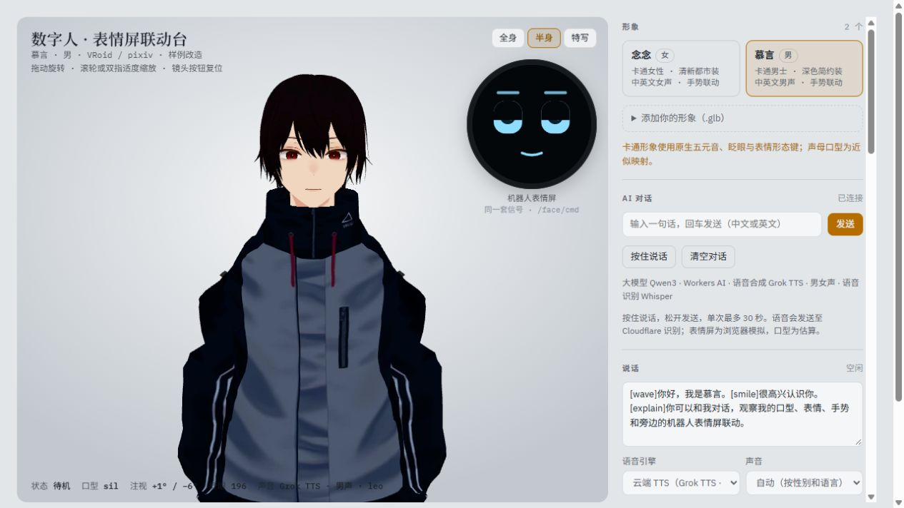

# AI Avatar & Robot Face Bridge

English | [简体中文](README.zh-CN.md)

**Live demo:** https://jason-digital-human-face.linghai2025001.workers.dev/

One set of signals drives two embodiments: a full-body 3D avatar you can talk to, and a simulated robot face screen. The avatar's state, expression tags, mouth shapes and gaze are sent to the face screen as `/face/cmd` messages in real time, so the same conversation could drive a physical robot's display.



- Frontend: plain JavaScript + three.js, built with Vite, no UI framework
- Backend: a Cloudflare Worker on the same origin. Workers AI runs the chat (Qwen3) and speech recognition (Whisper); speech synthesis uses Grok TTS through Cloudflare AI, with gender-matched Chinese and English voices
- Lip sync: Chinese text is split into initials and finals with `pinyin-pro`, English is approximated letter by letter, and the resulting 15 viseme slots are mapped onto the avatars' five native vowel shapes
- Robot face: a four-layer Canvas face (emotion, mouth, gaze, idle) driven by a priority state machine
- 21 tests with `node --test`

The UI is in Chinese.

## Quick start

Requires Node 22.

```bash
npm ci
npm run dev            # http://127.0.0.1:5195
npm test               # request validation, stream parsing, rate limits, avatar rigs, lip-sync timing
```

`npm run dev` proxies `/api` to the public demo Worker (see `vite.config.js`), so chat and speech work locally without a Cloudflare account.

To deploy your own copy, change `name` and `account_id` in `wrangler.jsonc`, then run `npm run deploy`. The Worker reads the author profile that the avatar introduces from `worker/profile.mjs`. That file is git-ignored; in a fresh clone, `npm test` and `npm run deploy` create it from `worker/profile.example.mjs`.

Other commands:

```bash
npm run build          # static build to dist/
npm run preview
npm run build:single   # single-file build to dist-single/index.html, models embedded
npm run typecheck      # generates Worker binding types, then runs tsc
npm run deploy:check   # build and Worker dry run
npm run avatars:cartoon   # rebuild the two avatars from the original VRoid files
```

## How the bridge works

Every frame, `src/face-screen.js` reads `digitalHuman._signals()` and turns changes into messages for the face screen:

| Avatar signal | Message | Rule |
| --- | --- | --- |
| State | `{"type":"face","name":"listening"}` | States (`neutral`, `listening`, `thinking`, `sleep`) are fallback targets. A state that arrives while a reaction is still showing is remembered and applied when the reaction ends. |
| Expression tag | `{"type":"face","name":"happy"}` | `smile` → `happy`, `surprise` → `surprised`, `frown` → `sad`, `doubt` → `thinking`. Sent early by an adjustable lead (default 80 ms) to cover the screen's rendering delay. |
| Speech | `{"type":"speech","state":"start"}`, `{"type":"speech","viseme":"aa"}`, `{"type":"speech","state":"stop"}` | The strongest of the 15 visemes (`sil PP FF TH DD kk CH SS nn RR aa E I O U`), sent only when it changes, at most 30 times a second. |
| Gaze | `{"type":"gaze","x":0.3,"y":-0.1,"present":true}` | Eye yaw ±30° and pitch ±20°, normalized to -1…1. `present: false` lets the screen look around on its own. |

Blinking and breathing are not sent; the screen's idle layer generates them locally.

The face screen resolves conflicts by priority: fault > reaction > state > calm. Each face has a minimum hold time; reactions (`happy`, `sad`, `surprised`) fall back to the current state after 1.8–3 s; `error` stays until a `clear` message.

Expression events use the same format as the timeline events in [G1 Motion Review](https://github.com/tym3515/g1-motion-review): `{"t":1.5,"type":"face","name":"happy"}`.

The chat model starts sentences with tags such as `[wave] [explain] [shrug] [point] [bow] [nod] [shake] [smile] [surprise] [frown] [doubt] [neutral]`. Each tag triggers its gesture or expression when speech reaches it.

For debugging from the browser console, the page exposes `window.digitalHuman` (`speak`, `stop`, `chat`, `setState`, `gesture`, `setExpression`, `on`, `_signals`) and `window.faceScreen` (`send`, `state`).

## Backend API

All endpoints are same-origin and relative to the page.

| Endpoint | Request | Response |
| --- | --- | --- |
| `GET api/config` | — | `{ ok, mock, llm: {label}, tts: {label, genderMatched}, asr: {label} }` |
| `POST api/chat` | `{ messages: [{role, content}], avatarId }` | Server-sent events: `data: {"delta":"…"}`, ending with `data: [DONE]` |
| `POST api/tts` | `{ text, lang, avatarId }` | `{ audio: base64, gender, voiceId, voice, provider }` |
| `POST api/asr` | Audio blob (`audio/webm` and others) | `{ text }` or `{ error }` |
| `GET api/health` | — | Model names and profile version |

Limits and safeguards:

- Chat accepts only user and assistant messages: at most 16 messages, 4,000 characters each, 32 KiB of JSON. Speech synthesis takes at most 500 characters; audio is capped at 4 MiB.
- Rate limits per IP: 10 requests a minute for chat and for speech recognition, 30 for speech synthesis.
- Only same-origin requests and the local dev origin are accepted. No API key reaches the browser. Conversations and recordings are not stored, and message text is not logged.
- The server picks the voice from the avatar registry (`src/avatars.mjs`); clients cannot override it. Synthesized audio is only fetched from Cloudflare's own output host, with type, size, timeout and redirect checks.

## Avatars

Two cartoon avatars adapted from the official VRoid samples `AvatarSample_A` and `AvatarSample_C`: adult body proportions, reworked garments, bones and mouth shapes bound to the app's controls, and Meshopt-compressed to about 2 MiB each. They keep the native full-body skinning, five vowel mouth shapes, separate blinking and expressions. They do not have 52 ARKit blend shapes or 15 independent viseme shapes.

You can also drag your own compatible GLB into the viewport, or register one in `src/avatars.mjs`.

To rebuild the avatars, download the source VRM files listed in `assets/vroid-sources/README.md` (with SHA-256 hashes) and run `npm run avatars:cartoon`.

## Known limits

- No real face screen, ROS 2 or WebSocket is connected. The face screen is a Canvas simulation and messages stay inside the page; real delivery, clock sync and display latency calibration need the device.
- No DragonBones art yet. The Canvas face follows the agreed bone, slot and layer layout, so art can replace the drawing code alone.
- Mouth timing is estimated from pinyin and calibrated against the audio's voiced segments and pauses. It is not phoneme-level alignment; precise lip sync needs a TTS service that returns viseme timestamps, or forced alignment.
- Tested on desktop Chromium (including software rendering) and at 400 px phone width only; frame rate on real phones and low-end devices is unmeasured.

## Layout

```
index.html                 page structure
src/main.js                entry: styles → avatar → face screen
src/digital-human.js       avatar: loading and rigging, poses and gestures, mouth plan, speech engines, chat, public API
src/face-screen.js         face screen: message handling, bridge, four-layer Canvas face, interface reference table
src/lip-sync.mjs           voiced-segment alignment, silence handling, chunked speech, bounded subtitles
src/avatars.mjs            avatar, name, gender and voice registry shared by page and Worker
src/stream.mjs             SSE parser (split chunks, CRLF, completion marker)
worker/index.js            same-origin chat, TTS and ASR endpoints with rate limits
worker/protocol.mjs        bounded body reads, message validation, base64 audio
worker/profile.example.mjs example author profile for the chat prompt
public/avatars/            the two avatar GLBs and their licenses
scripts/                   avatar conversion and compression, single-file build
wrangler.jsonc             Worker assets, AI binding, rate limits, observability
```

## Data and licenses

- Code: MIT
- Avatars: derived from VRoid / pixiv sample models under the [VRoid sample conditions](https://vroid.pixiv.help/hc/en-us/articles/4402394424089-VRoidPreset-A-Z). They are not MIT or CC0; see [public/avatars/VRoid-LICENSE.md](public/avatars/VRoid-LICENSE.md).
- AI services: Cloudflare Workers AI (Qwen3, Whisper) and Grok TTS through Cloudflare AI. Deploying your own copy bills your Cloudflare account.
