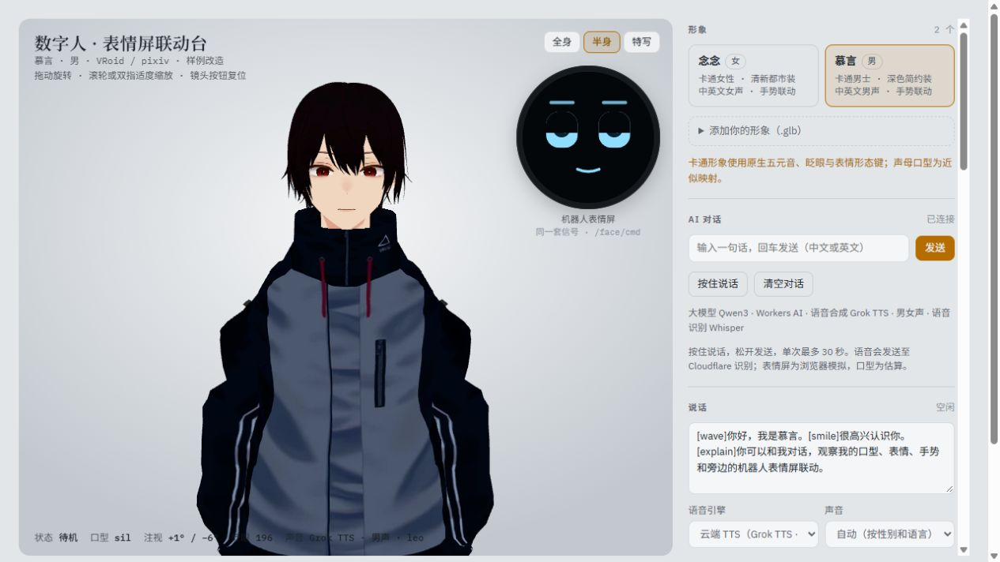

# 数字人与机器人表情屏联动台

[English](README.md) | 简体中文

**在线演示：** https://jason-digital-human-face.linghai2025001.workers.dev/

一套信号同时驱动两种形态：一个能对话的 3D 全身数字人，和一块模拟的机器人表情屏。数字人的状态、表情标签、口型和视线，实时以 `/face/cmd` 消息发给表情屏。同一段对话，换成真机就能驱动机器人的屏幕。



- 前端：原生 JavaScript + three.js，Vite 构建，没有 UI 框架
- 后端：同源部署的 Cloudflare Worker。对话（Qwen3）和语音识别（Whisper）走 Workers AI；语音合成走 Cloudflare AI 上的 Grok TTS，中英文男女声按人物性别匹配
- 口型：中文用 `pinyin-pro` 拆声母和韵母，英文按字母近似，生成 15 个 viseme 槽位，再映射到形象原生的五个元音口型
- 表情屏：Canvas 绘制的四层脸（情绪、口型、视线、待机），由优先级状态机驱动
- 21 个测试，用 `node --test` 运行

## 快速开始

需要 Node 22。

```bash
npm ci
npm run dev            # http://127.0.0.1:5195
npm test               # 请求校验、流解析、限流、形象骨骼、口型对时
```

`npm run dev` 会把 `/api` 代理到公开的演示 Worker（见 `vite.config.js`），本地不用 Cloudflare 账号也能对话和朗读。

部署自己的副本：改 `wrangler.jsonc` 里的 `name` 和 `account_id`，再运行 `npm run deploy`。数字人介绍的作者资料来自 `worker/profile.mjs`。这个文件不进 Git；新克隆的仓库里，`npm test` 和 `npm run deploy` 会自动从 `worker/profile.example.mjs` 复制一份。

其他命令：

```bash
npm run build          # 静态构建到 dist/
npm run preview
npm run build:single   # 打成单文件 dist-single/index.html，模型内嵌
npm run typecheck      # 先生成 Worker 绑定类型，再跑 tsc
npm run deploy:check   # 构建并预检 Worker 部署
npm run avatars:cartoon   # 从原始 VRoid 文件重建两款形象
```

## 联动怎么工作

`src/face-screen.js` 每帧读取 `digitalHuman._signals()`，把变化转成消息发给表情屏：

| 数字人信号 | 消息 | 规则 |
| --- | --- | --- |
| 状态 | `{"type":"face","name":"listening"}` | 状态（`neutral`、`listening`、`thinking`、`sleep`）是回落目标。反应类表情还在显示时收到的状态会被记下，等反应结束再切过去。 |
| 表情标签 | `{"type":"face","name":"happy"}` | `smile` → `happy`，`surprise` → `surprised`，`frown` → `sad`，`doubt` → `thinking`。按可调的提前量（默认 80 毫秒）提前发送，抵消屏幕渲染延迟。 |
| 说话 | `{"type":"speech","state":"start"}`、`{"type":"speech","viseme":"aa"}`、`{"type":"speech","state":"stop"}` | 取 15 个 viseme（`sil PP FF TH DD kk CH SS nn RR aa E I O U`）里权重最大的一个，变化时才发，每秒最多 30 次。 |
| 视线 | `{"type":"gaze","x":0.3,"y":-0.1,"present":true}` | 眼球偏航 ±30°、俯仰 ±20°，归一化到 -1…1。`present: false` 时屏幕自己随机扫视。 |

眨眼和呼吸不发送，由表情屏的待机层在本地生成。

表情屏按优先级处理冲突：故障 > 反应 > 状态 > 平静。每种表情有最短保持时间；反应类（`happy`、`sad`、`surprised`）1.8–3 秒后回落到当前状态；`error` 一直保持，直到收到 `clear`。

表情事件和 [G1 动作审核台](https://github.com/tym3515/g1-motion-review) 的时间轴事件格式一致：`{"t":1.5,"type":"face","name":"happy"}`。

对话模型会在句首加 `[wave] [explain] [shrug] [point] [bow] [nod] [shake] [smile] [surprise] [frown] [doubt] [neutral]` 这类标签，朗读到标签所在位置时触发对应的手势或表情。

方便在浏览器控制台调试，页面暴露了 `window.digitalHuman`（`speak`、`stop`、`chat`、`setState`、`gesture`、`setExpression`、`on`、`_signals`）和 `window.faceScreen`（`send`、`state`）。

## 后端接口

所有接口都是同源相对路径。

| 接口 | 请求 | 返回 |
| --- | --- | --- |
| `GET api/config` | — | `{ ok, mock, llm: {label}, tts: {label, genderMatched}, asr: {label} }` |
| `POST api/chat` | `{ messages: [{role, content}], avatarId }` | SSE：`data: {"delta":"…"}`，以 `data: [DONE]` 结束 |
| `POST api/tts` | `{ text, lang, avatarId }` | `{ audio: base64, gender, voiceId, voice, provider }` |
| `POST api/asr` | 录音 Blob（`audio/webm` 等） | `{ text }` 或 `{ error }` |
| `GET api/health` | — | 模型名称和资料版本 |

限制与防护：

- 对话只接受 user 和 assistant 消息：最多 16 条，每条 4000 字，JSON 不超过 32 KiB。朗读最多 500 字，音频不超过 4 MiB。
- 按 IP 限流：对话和语音识别每分钟各 10 次，语音合成每分钟 30 次。
- 只接受同源请求和本地调试来源。API 密钥不会发到浏览器，不保存对话和录音，日志里不记录正文。
- 声音由服务端按人物注册表（`src/avatars.mjs`）选择，客户端不能改。合成音频只从 Cloudflare 自己的输出域名下载，并检查类型、大小、超时和重定向。

## 形象

两款卡通形象改自 VRoid 官方样例 `AvatarSample_A` 和 `AvatarSample_C`：调整成成人身材比例，改了服装，把骨骼和口型绑定到应用的控制上，用 Meshopt 压缩到每个约 2 MiB。保留了原生全身蒙皮、五个元音口型、独立眨眼和表情；没有 52 个 ARKit 表情，也没有 15 个独立的音素口型。

也可以把兼容的 GLB 直接拖进视口，或在 `src/avatars.mjs` 里注册。

重建形象：按 `assets/vroid-sources/README.md` 里的地址和 SHA-256 下载原始 VRM 文件，再运行 `npm run avatars:cartoon`。

## 已知限制

- 没有接入真实表情屏、ROS 2 或 WebSocket。表情屏是 Canvas 模拟，消息只在页面内传递；真机下发、时钟同步和屏幕延迟标定需要对应设备。
- 还没有 DragonBones 美术资源。Canvas 按约定的骨骼、插槽和图层画脸，换成美术资源时只替换绘制部分。
- 口型时间按拼音估算，再按音频的发声段和停顿校准，不是音素级对齐。精确口型需要能返回 viseme 时间戳的语音服务，或者强制对齐。
- 只在桌面 Chromium（含软件渲染）和 400 px 手机宽度下验证过，没有在真机和低端设备上测过帧率。

## 目录

```
index.html                 页面结构
src/main.js                入口：样式 → 数字人 → 表情屏
src/digital-human.js       数字人：加载与绑定、姿势与手势、口型计划、语音引擎、对话、对外接口
src/face-screen.js         表情屏：消息处理、联动桥、四层 Canvas 脸、接口约定表
src/lip-sync.mjs           发声段对时、静音处理、分块朗读、有限长度字幕
src/avatars.mjs            页面和 Worker 共用的形象、姓名、性别、声音注册表
src/stream.mjs             SSE 解析（分片、CRLF、完成标记）
worker/index.js            同源对话、TTS、ASR 接口与限流
worker/protocol.mjs        有界读取、消息校验、音频 base64 转换
worker/profile.example.mjs 对话提示词里的作者资料示例
public/avatars/            两款形象的 GLB 和许可说明
scripts/                   形象转换与压缩、单文件构建
wrangler.jsonc             Worker 静态资源、AI 绑定、限流、可观测性配置
```

## 数据与许可

- 代码：MIT
- 形象：改自 VRoid / pixiv 官方样例，适用 [VRoid 样例使用条件](https://vroid.pixiv.help/hc/en-us/articles/4402394424089-VRoidPreset-A-Z)，不是 MIT 或 CC0，详见 [public/avatars/VRoid-LICENSE.md](public/avatars/VRoid-LICENSE.md)。
- AI 服务：Cloudflare Workers AI（Qwen3、Whisper）和 Cloudflare AI 上的 Grok TTS。部署自己的副本会计入你自己的 Cloudflare 账单。
